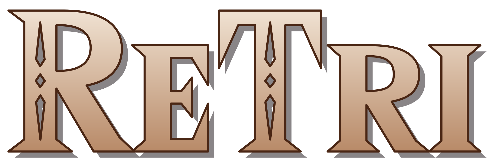
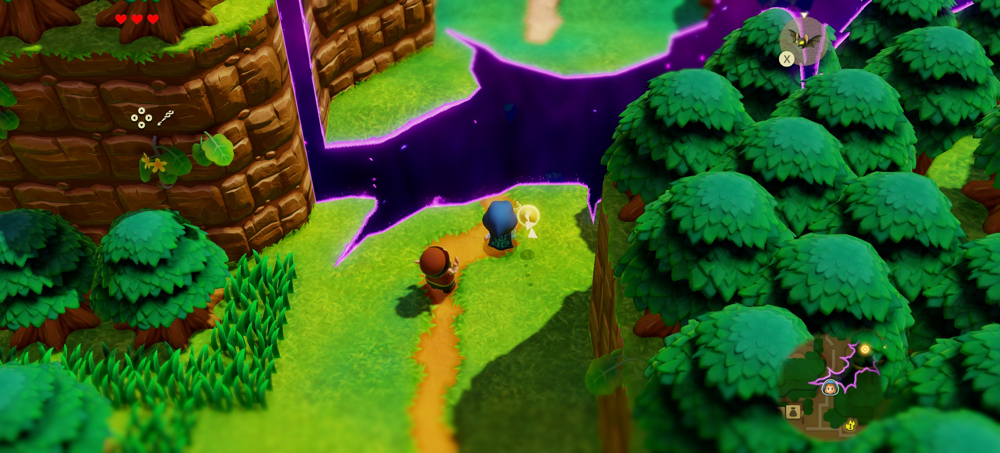
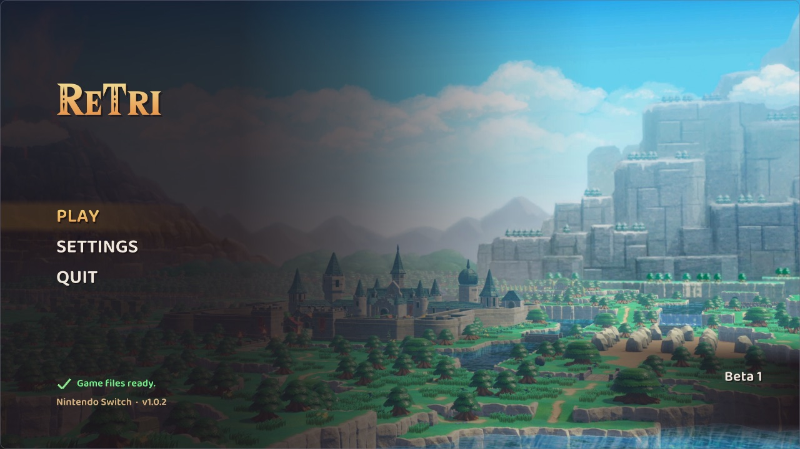

<h1></h1>

> [!IMPORTANT]
> **This project was made almost exclusively with AI.** Nearly all of the code, tooling, reverse engineering and
> documentation in this repository was written by and will be maintained by an AI (Anthropic's Claude, through Claude Code),
> directed, tested and reviewed by a human. As a huge fan of this game, I made this for myself. Sharing it is a courtesy.
> If you don't agree with the use of AI or don't trust code written by AI, that is your right, but I'm not interested
> in the controversy in relation to this project. You may simply ignore this project and its code.
> As with anything on the internet, you run the code at your own discretion.

**ReTri** is a static recompilation of *The Legend of Zelda: Echoes of Wisdom* (Nintendo Switch, 2024) into a
native Windows, macOS, Linux, Android and iOS application. It is built on the runtime of
[LAS Recomp](https://github.com/peiikai/LASRecomp), the same kind of port for *Link's Awakening*.

> [!NOTE]
> Currently supported platforms:
> - macOS - Apple Silicon only, Metal graphics backend + MetalFX
> - Windows - x86-64 only, Vulkan graphics backend
> - Linux - x86-64, Vulkan graphics backend (AppImage)
> - Android - arm64, Vulkan graphics backend
> - iPhone and iPad - arm64, Metal graphics backend (sideloaded: see [iPhone and iPad](#iphone-and-ipad))
> - Windows on ARM (arm64) and Linux aarch64 (ARM) - **experimental**: on the [releases](https://github.com/peiikai/ReTri/releases)
>   page; reports welcome ([docs/linux.md](docs/linux.md) lists what to include)

## System requirements

These are the minimums during the beta and may change as development continues.

**macOS:** any Apple Silicon Mac (M1 or newer) on macOS 15 or newer. Intel Macs aren't supported.

**Windows and Linux:**

| | Minimum |
|---|---|
| OS | Windows 10 or 11 (64-bit), or 64-bit Linux from about 2022 or newer (including the Steam Deck) |
| CPU | x86-64 with AVX2 and FMA: Intel 4th gen (Haswell) or newer, or AMD Ryzen |
| GPU | Vulkan 1.3 with an up-to-date driver, about as fast as a Switch or faster. For example: NVIDIA GTX 900 series or newer, AMD Radeon RX 400 series or Ryzen integrated graphics or newer, Intel Iris Xe or newer |
| RAM | 8 GB (16 GB recommended) |
| Disk | About 12 GB free for setup |

**Android:**

| | Minimum |
|---|---|
| OS | Android 11 or newer, 64-bit (arm64) |
| Chip | Snapdragon 865 (Adreno 650) or as fast, for example the Retroid Pocket 5 |
| GPU driver | Vulkan 1.3. Older Adreno phones ship a Vulkan 1.1 driver: pick a Turnip driver package in Settings > System. The latest we've tested is [Turnip 26.3.0 R6](https://github.com/StevenMXZ/Adreno-Tools-Drivers/releases/tag/v37) (`Turnip_v26.3.0-R6.zip`) from StevenMXZ's Adreno-Tools-Drivers |
| RAM | 8 GB |
| Storage | About 15 GB free |

> [!TIP]
> We recommend turning on Dynamic resolution and choosing an FPS target. The resolution then adjusts to what your device
> can handle, and drops when the chip heats up and slows down, which most phones and tablets do over longer play.

> [!NOTE]
> Some Qualcomm (Adreno) GPU drivers have many bugs, even on newer phones. If you see graphical issues, try a Turnip
> driver (Settings > System, see the GPU driver row above) before you open an issue report.

**iPhone and iPad:**

| | Minimum |
|---|---|
| OS | iOS or iPadOS 16.4 or newer |
| Device | iPhone 15 Pro or newer iPad Pro (2021) or newer iPad Air (2022) or newer iPad mini (2024) or newer |
| Storage | About 15 GB free |

> [!TIP]
> We recommend turning on Dynamic resolution and choosing an FPS target. The resolution then adjusts to what your device
> can handle, and drops when the chip heats up and slows down, which most phones and tablets do over longer play.

> [!NOTE]
> **No game files are included.** ReTri needs your own legally obtained copy of the extracted game files of
> *Echoes of Wisdom* **v1.0.2**. When setting up, choose a folder that contains the `exefs`
> and `romfs` folders, or their contents. Instructions on how to obtain these files will **NOT** be provided.
> On first launch the app sets up what it needs, including the actual recompilation locally. No game files, assets or fonts are included.
> The screenshot shows the start screen after setup; no Nintendo artwork is included until provided by the user.

## Status

This is a beta release. That means bugs are likely, crashes could occur and some graphics issues remain (especially in wide and ultrawide aspect ratios). This is a work in progress, hence the beta designation. To report a bug, open a [GitHub issue](https://github.com/peiikai/ReTri/issues) - see [CONTRIBUTING.md](CONTRIBUTING.md#reporting-bugs) for what to include.

### Known issues

Known issues and their status are on the [GitHub issues page](https://github.com/peiikai/ReTri/issues).

## Steam Deck

- Add the AppImage to Steam as a non-Steam game and play it from there. In Desktop Mode, games Steam didn't launch
  get Steam's desktop controller layout, which sends extra keyboard presses.
- If it won't start, add this to the game's launch options in Steam: `APPIMAGE_EXTRACT_AND_RUN=1 %command%`

## Launchers

ReTri can be started from game launchers. `eowrecomp --help` lists the options: start the game directly, choose
the data folder, set up the game files without a window, change settings for one run. The Windows and Linux releases
include a profile for RecompLauncher. Details are in [docs/debug-hooks.md](docs/debug-hooks.md#command-line).

## iPhone and iPad

The iOS app is made on your computer from your own game files, then sideloaded.

1. Set up ReTri on a Mac, Windows or Linux computer as usual.
2. From the same release, download `ReTri-<version>-iOS.laskit`.
3. On the start screen, open Settings > System > Recomp for iOS..., choose the kit, then Export iOS app.
   The app is saved to your Downloads folder as `ReTri-<version>-iOS.ipa`.
4. Install the .ipa with a sideloading tool such as SideStore, AltStore or Sideloadly. A free Apple account works,
   but the app then has to be refreshed every 7 days. ReTri only makes the .ipa. Installing it is up to you,
   and we can't help with these tools since they're made by others. The extra steps come from Apple's limits on
   installing apps, not from ReTri.
5. Copy your game files folder (with `exefs` and `romfs` in it) to the phone or iPad:
   - Mac: connect it with a cable, select it in Finder's sidebar, open the Files tab and drag the folder onto
     ReTri.
   - Windows: the same in the Apple Devices app (or iTunes), under Files > ReTri.
   - USB-C drive: put the folder on the drive and plug it in (iPhone 15 or newer, USB-C iPads).
   - iCloud Drive: upload the folder, then in the Files app move it to On My iPhone (or On My iPad). ReTri
     won't use game files that are still on iCloud Drive.
6. Open the app and choose that folder when it asks for your game files. Use the same game version as the files
   on your computer.

### Increased Memory Limit

ReTri asks iOS for more memory than a normal app gets. iOS only grants it when the tool that signs the app also
turns on Increased Memory Limit for the app's App ID. Not every tool does. Without it, iOS may close the game when it
needs more memory, and the start screen says "Installed without the increased memory limit".

| How the app is installed | Keeps it |
|---|---|
| AltStore Classic 2.2 or newer | Yes |
| [Impactor](https://github.com/claration/impactor), from a computer | Yes |
| Xcode, with a free (Personal Team) or paid Apple account | Yes |
| SideStore 0.7.0 with a free Apple account | No |
| Sideloadly and other tools | Check the start screen |

If your sideloader didn't add it, see [docs/ios.md](docs/ios.md#increased-memory-limit) for a one-time fix with
GetMoreRam. More on the iOS app is there too.

## Features

- **This is not emulation.** It runs natively on Windows, macOS, Linux, Android, iPhone and iPad.
- Works with game version 1.0.2.
- Wider screens show more of the world, up to ultrawide: the camera, the echo list and the pause screen fill the
  window. You can switch back to the original 16:9.
- Higher resolutions, a "match your display" option and dynamic resolution with an FPS target, with MetalFX (Mac)
  or FSR 1 (Windows, Linux and Android) upscaling and SMAA anti-aliasing.
- Sharper shadows, and an option to remove the tilt-shift blur.
- Shaders are prepared ahead of time, so new areas don't stutter.
- In-game menu: F1, or Home or Minus + Plus on a controller.
- Keyboard, controller and touch controls, with every button remappable and a touch layout editor. Button icons
  match your controller (Xbox, PlayStation or Nintendo).
- Stereo or 5.1 surround sound.
- Can be started from game launchers, with a profile for RecompLauncher (see [Launchers](#launchers)).

## Building from source

Every platform needs your own game files (v1.0.2): build first, then use the start screen's game-file setup.
`make gen` then recompiles the game code from your own game files into `generated/` (the generator, `build/lasgen`, is
built first), and `make` builds it into its own library next to the app (`build/eowgame.*`); without it the start
screen builds that library itself, as it does for players. Release builds hold none of the game's code: the start
screen builds it on each player's machine from their own game files, with the generator built into the app and the
bundled compiler (`tools/fetch_zig.sh`). The generator needs no Python; Python 3 is still used by some dependency and
packaging scripts and by the tests.

### macOS

Requirements: Apple Silicon, Xcode command line tools (clang), [Homebrew](https://brew.sh) `sdl3` and `ffmpeg`.

1. Build: `make -j10` -> `build/eowrecomp`. Set up your game files (above), then `make gen` and `make -j10` again.
2. Run: `./build/eowrecomp extracted` (start screen) or `./build/eowrecomp extracted --play` (straight into the game).
3. Package: `make deps` (once: SDL3 and FFmpeg from pinned sources, built for macOS 15) and `tools/fetch_zig.sh`
   (what the start screen builds the game code with), then `make app` -> `build/ReTri.app` (macOS 15+, Apple Silicon)
   and `make dmg` -> `build/dist/ReTri-<version>-macOS.dmg`.

### Windows

Requirements: Windows 10+ x86-64, a CPU with AVX2 and a GPU with Vulkan 1.3. More detail in
[docs/BUILD-windows.md](docs/BUILD-windows.md). Windows on ARM (experimental) builds with the same setup script; see
that page.

1. One-time setup, in PowerShell from the repo root: `powershell -ExecutionPolicy Bypass -File tools\setup_windows.ps1`.
   It installs MSYS2 (UCRT64: clang, make, SDL3, FFmpeg, Vulkan, shaderc), Python 3.12 for the tests and switches the
   clone to LF line endings.
2. Build, from an MSYS2 UCRT64 shell (or Git Bash with `export PATH="/c/msys64/ucrt64/bin:/c/msys64/usr/bin:$PATH"`):
   `make -j` -> `build/eowrecomp.exe`. Set up your game files (above), then `make gen` and `make -j` again.
3. Run: `./build/eowrecomp.exe extracted`, from a shell with `C:\msys64\ucrt64\bin` on PATH (for the DLLs).
4. Package: `make deps-windows` (once: LGPL FFmpeg) and `tools/fetch_zig.sh`, then `make dist` ->
   `build/dist/ReTri-<version>-windows-x64.zip`.

### Linux

Requirements: x86-64 with AVX2 (or aarch64, experimental), a GPU with Vulkan 1.3, clang, SDL 3.4 or newer, FFmpeg,
shaderc and Vulkan Memory Allocator from your distribution. Packages, cross builds and details in
[docs/linux.md](docs/linux.md).

1. Build: `make -j` -> `build/eowrecomp`. Set up your game files (above), then `make gen` and `make -j` again.
2. Run: `./build/eowrecomp extracted`.
3. Package: `make appimage` (this machine's arch; `ARCH=aarch64` cross-compiles) or `make appimages` (both) ->
   `build/dist/ReTri-<version>-linux-<arch>.AppImage`, built in Ubuntu 22.04 containers (podman). `make smoketest`
   checks the x86-64 AppImage before a release.

Where files live (game files, saves, settings and logs):
- macOS: `~/Library/Application Support/com.peiikai.eowrecomp/`
- Windows: next to `eowrecomp.exe`, so keep the `ReTri` folder somewhere writable (not Program Files).
- Linux: `~/.local/share/eowrecomp/` (the tarball: its own folder; see [docs/linux.md](docs/linux.md))
- Android: `Android/data/com.retri.android/files` in the phone's storage.
- iPhone and iPad: the app's folder in Files (On My iPhone / On My iPad > ReTri).
- You can move it to another folder or drive in Settings > System > Data folder.
- `--data-dir <dir>` (or `LARECOMP_DATA_ROOT=<dir>`) overrides all of these.
- For a bug report, attach `eowrecomp.log` from that folder.

### Android

Requirements: the Android SDK with NDK 30.0.16248370, CMake 3.30.4 and platform 36, JDK 17 or newer, bash, curl and
Python 3 (for the dependency script). Details in [docs/android.md](docs/android.md).

1. Dependencies (once): `bash android/deps/build_deps.sh` and `bash android/deps/build_gen_deps.sh`.
2. Build: `cd android && ./gradlew assembleDebug` -> `android/app/build/outputs/apk/debug/app-debug.apk`.
3. Install it on the phone and set up your game files from the start screen. The game code is built on the phone.

### Resuming game-code builds

If the game-code build is cancelled or interrupted, **Resume game code** continues where it stopped. It also resumes
by itself the next time ReTri starts. **System > Clear build cache** removes the build's leftover files
without touching the installed game, your game files or your saves.

## Credits

**[LAS Recomp](https://github.com/peiikai/LASRecomp)** - ReTri runs on its runtime: the host, the graphics backends,
the menus, the ports and the game code builder all come from it.

**LAS Recomp contributors** - their code is in ReTri too. Thank you to everyone who has sent code (GitHub handles, in
order of first contribution; the numbers are LAS Recomp pull requests):
- **[@dvilelaf](https://github.com/dvilelaf)** - the System language setting (#15), a packaging fix (#10) and the
  level-transition crash fix (#34)
- **[@Tensorlong](https://github.com/Tensorlong)** - the fix for the white Link on M1 Macs (#18)
- **[@mansarip](https://github.com/mansarip)** - support for unrecognised controllers (#26)
- **[@we11adam](https://github.com/we11adam)** - the right font for each language (#27) and the Chinese language
  codes (#25)
- **[@Maganra](https://github.com/Maganra)** - faster graphics checks on Linux (#42)
- **[@hjqcan](https://github.com/hjqcan)** - game addresses in one place (#57), settings and Traditional Chinese fixes
  (#53), much less memory used on Windows (#107), Vulkan fixes (#108, #127, #128), an x86 rounding fix (#115), movie
  memory fixes (#112), Windows logs (#114), resumable game-code builds (#56), and save fixes (#169, #170, #182)
- **[@gitarre1234rr5](https://github.com/gitarre1234rr5)** - controller rumble (#104) and a regression test (#88)
- **[@rkammoun](https://github.com/rkammoun)** - the fix for the black walls in the Ukuku Prairie cave on Mac (#215, #216)
- **[@NevesHenry](https://github.com/NevesHenry)** - a clear message on Linux when no file window can open (#298),
  the rumble test running in CI (#299), Linux builds finding their own SDL3 (#437), font re-imports that no longer
  empty the font (#490), a message box on Linux for a CPU without AVX2 (#491), the build and system in the log bot's
  summary (#582), an FFmpeg licence check that really checks (#583), the GPU driver in the log bot's summary (#588),
  each attached log counted once (#589), the game files check in the log bot's summary (#600), summaries for
  logs attached by editing a comment (#601), a Linux AppImage build that stops when its container fails (#653), and
  a zig download that starts over after being cut off (#667)
- **[@ky1vstar](https://github.com/ky1vstar)** - a much faster Linux ARM release build (#319), touch menus and on-screen controls for phones (#634), the frame interpolation presenter on CADisplayLink (#649), one shared macOS and iOS host layer (#685), the iOS cleanup after #238 (#697), iOS fixes for saves, errors and Files (#690), a safer, simpler iOS kit export (#704), seed generation on iOS that shows its progress and handles room shuffle re-runs (#735), a clear message on iPhones and iPads that can't run the game (#761), checksums for every iOS download (#762), and a leaner iOS CI job (#763)
- **[@theb0rg](https://github.com/theb0rg)** - the fix for AMD integrated graphics on Windows (#335)
- **[@gtf-dot](https://github.com/gtf-dot)** - the game-text font on Linux (#330)
- **[@cfcosta](https://github.com/cfcosta)** - full speed on Linux AMD handhelds like the Steam Deck and ROG Ally (#392)
- **[@gsel001](https://github.com/gsel001)** - a check in CI that the Mac app starts (#420), and rupees up to 9,999 in the
  cheats and save editor (#453)
- **[@wimw85](https://github.com/wimw85)** - much faster game code setup on the Steam Deck and other PCs (#434)
- **[@missionfloyd](https://github.com/missionfloyd)** - a much smaller game code build, without debug info (#487)
- **[@wolfchimneyrock](https://github.com/wolfchimneyrock)** - full speed on ARM Mali graphics (#527), the CPU and GPU working in parallel on Mali (#529), and faster render passes on Mali (#528, #534), a cheaper FSR upscale (#532), the game on the big cores of ARM and Intel hybrid CPUs on Linux (#533), no more flickering grass and shadows on Mali (#546), the game starting on Snapdragon (Adreno) devices (#561), much faster shaders on Mali and Adreno (#562, #563, #579), faster graphics memory on Mali with Mesa (#564), GPU tuning tools for Vulkan (#565), no more memory leak on Arm's Mali driver (#607), smaller shader stacks that keep 4 GB Mali boards from running out of memory (#645), and less shader scratch memory on PanVK (#646)
- **[@bgevko](https://github.com/bgevko)** - an option to keep the area's music during Guardian Acorns and Pieces of Power (#642)

**Mobile ports** - special thanks to the people who brought the game to phones and tablets:
- Android: **[@Nycolazs](https://github.com/Nycolazs)** ([LASRecomp-Android-Plus](https://github.com/Nycolazs/LASRecomp-Android-Plus))
  and **[@mamcjr](https://github.com/mamcjr)** ([LASRecompAndroid](https://github.com/mamcjr/LASRecompAndroid)), the
  Android ports our Android app is built from
- iOS: **[@ky1vstar](https://github.com/ky1vstar)** - the game on iPhone and iPad (#238)

Thanks also to everyone who reports issues and tests builds. Your logs and screenshots find most of the bugs.

**Art**
- **[Kenney](https://kenney.nl)** - the D-pad art, from the Input Prompts pack (CC0,
  `third_party/kenney`)

**Libraries and tools**
- [SDL 3](https://libsdl.org) - windowing, input, audio (zlib license)
- [FFmpeg](https://ffmpeg.org) - movie playback (LGPL)
- [Dear ImGui](https://github.com/ocornut/imgui) - overlay menu and start screen (MIT)
- [Hylia Serif](https://artsyomni.com/hyliaserif) by Omni Jacala - the start screen's title and this page's header (free, not for profit; `third_party/fonts/HyliaSerif/README.md`)
- [Baloo 2](https://github.com/EkType/Baloo2) by Ek Type - the start screen's font (SIL Open Font License 1.1, `third_party/fonts/Baloo2/OFL.txt`)
- [BIZ UDPGothic](https://github.com/googlefonts/morisawa-biz-ud-gothic) by Morisawa - the game's text on Linux when you haven't imported the Switch fonts: a free font from the same universal-design gothic family as the Switch's UD Shin Go (SIL Open Font License 1.1, `third_party/fonts/BIZUDPGothic/OFL.txt`)
- [DejaVu Sans](https://dejavu-fonts.github.io) - the in-game menu and button letters when no system font fits, and the game text's last resort (Bitstream Vera / DejaVu license, `third_party/fonts/DejaVu/LICENSE`)
- [Vulkan Memory Allocator](https://github.com/GPUOpen-LibrariesAndSDKs/VulkanMemoryAllocator) - Windows and Linux renderer (MIT)
- [SMAA](https://github.com/iryoku/smaa) by Jorge Jimenez, Jose I. Echevarria, Belen Masia, Fernando Navarro and Diego
  Gutierrez - the anti-aliasing option (MIT, `third_party/smaa/LICENSE.txt`)
- [AMD FidelityFX Super Resolution 1](https://github.com/GPUOpen-Effects/FidelityFX-FSR) - the Windows and Linux upscaler
  option, ported to GLSL (MIT)
- The iOS app links SDL 3 and FFmpeg statically. Their licence texts ship in the app (`LICENSES/`).
- [Zig](https://ziglang.org) - its C compiler (`zig cc`: Clang and LLD) builds the game code on the player's
  machine during setup (MIT; LLVM, Clang, LLD: Apache 2.0 with LLVM exceptions)
- [shaderc](https://github.com/google/shaderc) - compiles the translated shaders for Vulkan on Windows, Linux and
  Android (Apache 2.0; with glslang and SPIRV-Tools)
- The Android app, ported from [LASRecompAndroid](https://github.com/mamcjr/LASRecompAndroid) by mamcjr (MIT), also
  ships [volk](https://github.com/zeux/volk) by Arseny Kapoulkine (MIT) to load Vulkan, and
  [libadrenotools](https://github.com/bylaws/libadrenotools) and
  [liblinkernsbypass](https://github.com/bylaws/liblinkernsbypass), Copyright (c) 2021, Billy Laws (BSD 2-Clause; their
  licence text ships in the app), to load a custom Vulkan driver such as Turnip (not included)
- [envytools](https://github.com/envytools/envytools) - NVIDIA GPU documentation used for the shader translator
- An MIT-licensed open-source project's audio renderer and shader instruction decoders (license and copyright notice:
  `third_party/ryujinx/LICENSE.txt`) - the audio renderer's reverb is a port of its reverb code and the mixer is
  modelled on its renderer; its instruction decoders were the bit-layout reference for parts of the shader translator
- [XC2-Recomp-Contributions](https://github.com/circerio/XC2-Recomp-Contributions) by circerio (MIT) - the
  branch-phi test shader in the shader translator's control-flow test (`tools/test_translate_flow.c`)
- **Dusklight** by the TwilitRealm team (https://github.com/TwilitRealm/dusklight) - design inspiration for the start
  screen (Play / Settings / System layout)
- **SuperMarioWonderRecomp** by BelmanteGu (https://github.com/BelmanteGu/SuperMarioWonderRecomp) - its
  ahead-of-time shader approach is what the first-launch shader preparation follows (a shipped list of shader variants,
  built on the player's machine from their own game files)
- The Switch homebrew community's documentation ([Switchbrew](https://switchbrew.org))

## Legal

ReTri is a fan project. It is not affiliated with, endorsed by or sponsored by Nintendo. *The Legend of Zelda*,
*Echoes of Wisdom* and *Link's Awakening* are trademarks of Nintendo. No game files, game code, assets or fonts are included - not in
this repository and not in release builds. You must provide your own legally obtained copy of the game files to play.

## License

ReTri's own code (the recompiler tools, the runtime) is open source under the
[MIT License](LICENSE). Third-party components keep their own licenses: ported audio renderer code (MIT, see `third_party/`), Dear ImGui (MIT),
Vulkan Memory Allocator (MIT), SMAA (MIT), AMD FSR 1 (MIT), the Baloo 2 and BIZ UDPGothic fonts (SIL OFL 1.1), the Hylia Serif font (free, not for profit), the DejaVu Sans font (Bitstream Vera / DejaVu license), SDL 3 (zlib), FFmpeg (LGPL 2.1+, linked dynamically, and statically in the iOS app), the
Zig compiler (MIT; its LLVM / Clang / LLD: Apache 2.0 with LLVM exceptions; its C library headers keep their own
licenses), the iOS kit's Mach-O linker (LLD as built by the Rust project: Apache 2.0 with LLVM exceptions), miniz
(MIT: the iOS kit and the .ipa it makes). The iOS app links SDL 3 and FFmpeg (LGPL 2.1+) statically; the app's `LICENSES/` folder carries each one's licence text, its sources are this repository
plus the versions in the table (the LGPL libraries can be relinked: `make deps-ios` builds them from source, `make ipa`
the app), and the game code library it embeds is built from the player's own game files and never shared. The license covers ReTri's code only - it grants
nothing for Nintendo's game, which you must supply yourself.

### Source code of bundled third-party components

Release builds include these components; their source code for the exact versions shipped is available here:

| Component | Version | License | Source |
|---|---|---|---|
| Zig (builds the game code during setup; includes LLVM, Clang, LLD) | 0.17.0 | MIT; LLVM: Apache 2.0 with LLVM exceptions | https://ziglang.org/download/0.17.0/zig-0.17.0.tar.xz |
| LLD, as rust-lld (iOS kit: links the iOS game code on each desktop) | Rust 1.91.0 (LLVM 21.1.2) | Apache 2.0 with LLVM exceptions | https://static.rust-lang.org/dist/rustc-1.91.0-src.tar.xz, https://github.com/rust-lang/llvm-project |
| miniz (reads the iOS kit, writes the .ipa) | 3.0.2 | MIT | https://github.com/richgel999/miniz/releases/tag/3.0.2 |
| FFmpeg (LGPL configuration; dynamic on macOS, Windows and Linux, in the Android builds, static in the iOS app: `make deps-ios` relinks it from this source) | 9.0.2 | LGPL 2.1+ | https://ffmpeg.org/releases/ |
| SDL 3 | 3.4.18 (macOS, Windows; iOS, static, with `tools/patches/SDL3-3.4.18-ios27-orientation.patch`), 3.4.16 (Linux, Android) | zlib | https://github.com/libsdl-org/SDL/releases/tag/release-3.4.18, https://github.com/libsdl-org/SDL/releases/tag/release-3.4.16 |
| shaderc (Windows, Linux, Android: GLSL to SPIR-V; Linux, Android: with glslang, SPIRV-Tools inside) | 2026.4 (Windows), 2026.3 (Linux, Android) | Apache 2.0 | https://github.com/google/shaderc |
| libiconv (Windows: used by SDL 3) | 1.19 | LGPL 2.1+ | https://ftp.gnu.org/pub/gnu/libiconv/libiconv-1.19.tar.gz |
| GCC runtime: libgcc, libstdc++ (Windows) | 16.2.0 | GPL 3.0 with the GCC Runtime Library Exception | https://gcc.gnu.org/ |
| winpthreads (Windows, mingw-w64) | 14.0.0 | MIT / BSD | https://www.mingw-w64.org/ |
| Hylia Serif font (Beta) | 0.009 | Free, not for profit (no license file) | https://artsyomni.com/hyliaserif |
| Baloo 2 font (SemiBold) | 1.640 | SIL OFL 1.1 | https://github.com/EkType/Baloo2 |
| BIZ UDPGothic font (Regular, Linux) | 1.05 (Google Fonts) | SIL OFL 1.1 | https://github.com/googlefonts/morisawa-biz-ud-gothic, https://github.com/google/fonts/tree/main/ofl/bizudpgothic |
| DejaVu Sans font (Book, Bold) | 2.37 | Bitstream Vera license (DejaVu changes public domain) | https://github.com/dejavu-fonts/dejavu-fonts/releases/tag/version_2_37 |
| SMAA (shader and lookup textures, built in) | 2013 (repository master) | MIT | https://github.com/iryoku/smaa |

The exact build scripts that fetch and build these (with checksums) are in this repository: `tools/build_deps_macos.sh`,
`tools/build_deps_windows.sh`, `tools/linux/build_deps.sh` and `tools/build_deps_ios.sh`. The Windows build takes SDL 3, shaderc, libiconv and the
compiler runtime from MSYS2's UCRT64 packages (https://packages.msys2.org, which links each package's source).
